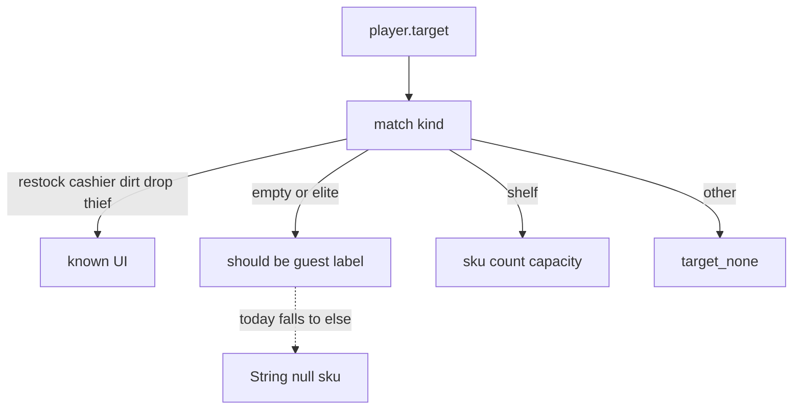

# Fix HUD `String()` crash + same-class scan

## Same class as before?

**Yes.** Godot 4 `String()` / `int()` / `bool()` reject `null`. `Object.get("sku")` on a guest returns `null` → `Nonexistent 'String' constructor` at [hud.gd](godot/game/scripts/hud.gd):565.

**Trigger (logic bug on top):** `_refresh_pane` only branches `restock|cashier|dirt|drop|thief`; **else assumes shelf**. Guests use `kind == ""`, elites `"elite"` ([customer.gd](godot/game/scripts/customer.gd)) — no `sku`/`capacity`. Delivery targeting a guest → every HUD tick crashes. Player already special-cases these kinds (~2481); HUD does not.

## Fix 1 — [hud.gd](godot/game/scripts/hud.gd) `_refresh_pane` (must)

1. Resolve `kind` once with null-safe coercion: `var kind := str(t.get("kind") if t.get("kind") != null else "")`.
2. Explicit branches:
   - existing: restock / cashier / dirt / drop / thief
   - **guest**: `kind == "" or kind == "elite"` → simple label (add `hud.target_guest` in [locale/strings.csv](godot/game/locale/strings.csv), CN/EN)
   - **shelf**: `kind == "shelf"` only → sku/count/capacity
   - **else**: `hud.target_none` (covers `drop_flight` and unknowns)
3. Inside shelf/drop branches, coerce safely:
   - `str(v) if v != null else ""` for strings (prefer `str` over `String` when null possible)
   - `int(v) if v != null else 0` for counts/capacity
4. Same pass: `bool(p.get("blocked_mismatch"))` → truthiness `p.get("blocked_mismatch") == true` or `if p.get("blocked_mismatch")`.

## Fix 2 — Same-class hot paths (scan follow-up)

Harden null-coercion where Object.get + ctor runs on interact targets (not a full-repo purge):

- [player.gd](godot/game/scripts/player.gd) `_target_detail_fp` (~1178–1191): `String(node.get("kind"))` / shelf-drop fields — use null-safe `str`/`int`; match guest kinds without reading sku.
- [player.gd](godot/game/scripts/player.gd) drop/shelf interact helpers that already assume kind (~2474, ~2491, ~3014, ~3199–3200): null-safe int/str after kind/is_instance_valid guards.
- [hud.gd](godot/game/scripts/hud.gd) drop branch ~561: same safe sku/count.

**Out of scope this pass:** every `String(sk.get(...))` on loadout **Dictionaries** (usually have keys); clerk/customer AI shelf loops that only touch real shelves; deferred InputMode hybrid work.

## Verify

- Face a guest (delivery) with HUD open: no Error; target shows guest label.
- Face a shelf: sku count/capacity still correct.
- Face dirt/restock/thief/drop: unchanged labels.