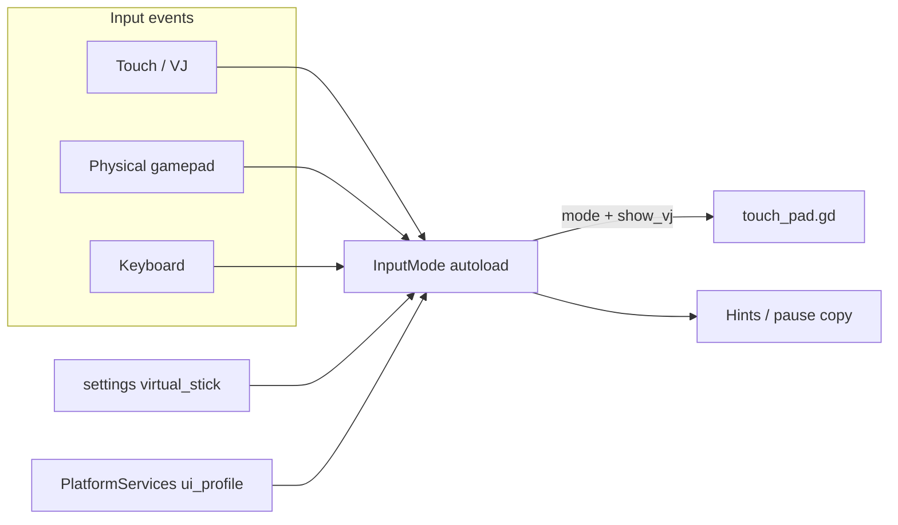

# Input modes + LoL-style VJ

## Decisions (locked)
- **Layout:** LoL 手機式右手簇（大「行動」核 + 衝刺／取消／奧義衛星 + 技2–5 弧）；左移動 VJ 保留。
- **Default:** VJ **預設關**（跟 tester／PM）。玩家可手動開；實體手掣或 keyboard 有效輸入時隱藏。
- **Manual toggles:** Prep **系統工具**（已有）＋ **Pause 選單**（今次加，同共用 `virtual_stick` pref）。
- **Module:** 要，但細——新 Autoload `InputMode` 專管三態與「應否顯示 VJ」；唔把 InputMap 或 TouchPad 繪製全塞進去。

## Answer: 而家有冇地方改？
**有一處。** 營運準備 → **系統工具** hub（[`prep/prep_pages.gd`](godot/game/scripts/prep/prep_pages.gd) `_hub_sys`）有「虛擬搖桿：開／關」，寫入 `user://settings.cfg` `[ui] virtual_stick`。  
- 只喺 Web／手機 `ui_profile=touch` 時真正影響顯示。  
- Pause 選單而家**冇**；計劃會加，與 Prep 共用同一 pref。  
- Code 預設而家係 **`true`（開）**；計劃會改成 **`false`（關）** 以符合 2B。

## Architecture



**三態 `InputMode.Mode`:** `TOUCH` | `GAMEPAD` | `KEYBOARD`

**顯示規則:**
```
show_vj =
  PlatformServices.wants_touch_pad()   # web/mobile only
  AND pref virtual_stick == true       # default false after change
  AND active_mode == TOUCH
```
- 實體手掣 button／stick 有效輸入 → `GAMEPAD` → 隱藏 VJ，並清所有虛擬 `set_hold(*, false)`。
- Keyboard（WASD／J/K/L/;／U 等）→ `KEYBOARD` → 隱藏。
- 螢幕觸控（或開啟 VJ 後再次 touch）→ `TOUCH` → 若 pref 開則再顯示。
- **唔好**只靠 `joy_connection_changed` 隱藏（防幽靈 pad）；以實際輸入為準。拔走最後一個 pad 且平台係 touch、pref 開 → 可回到可顯示狀態（mode 可保持或退回 TOUCH）。

## Module split
| 職責 | 放邊 |
|------|------|
| 活躍模式、`show_vj()`、`mode_changed` / `show_vj_changed` | 新 [`godot/game/scripts/input_mode.gd`](godot/game/scripts/input_mode.gd) Autoload |
| `virtual_stick` pref 讀寫、`ui_profile` | 維持 [`platform_services.gd`](godot/game/scripts/platform_services.gd)；`show_touch_pad()` 改 delegate 去 `InputMode` 或內部用同一公式，避免兩套真相 |
| InputMap／手掣軸輪詢 | 維持 [`controls.gd`](godot/game/scripts/controls.gd) |
| 繪製、縮放、觸控命中 | [`touch_pad.gd`](godot/game/scripts/touch_pad.gd) |

`demo.gd` 生成 TouchPad 後 subscribe `show_vj_changed`；`prep_menu`／`pause_menu` toggle 只改 pref，由 signal 更新可見性。

## Pause 選單開關
- 改 [`pause_menu.gd`](godot/game/scripts/pause_menu.gd)（及對應 scene 若有獨立按鈕節點）：在音效／音量列附近加「虛擬搖桿：開／關」。
- 呼叫 `PlatformServices.toggle_virtual_stick()`（或 `set_virtual_stick_enabled`），與 Prep 同一 `[ui] virtual_stick`。
- Focus 列要擴充（而家 `FOCUS_RESUME`／`SFX`／`VOL`／`END`）；手掣／鍵盤上下移動要包埋新項。
- 只喺 `PlatformServices.wants_touch_pad()` 時顯示該列（Desktop 原生唔出，避免無效開關）；Web／手機就算而家 mode 係 GAMEPAD／KEYBOARD 都顯示，方便玩家開返 VJ。
- 更新 [`docs/systemdesign/pausemenu.md`](docs/systemdesign/pausemenu.md) 與 `pause.*` locale。

## LoL-style TouchPad layout + 唔遮畫面
改 [`touch_pad.gd`](godot/game/scripts/touch_pad.gd) 右手由 Xbox 菱形改為：
- **大核：** `interact`（行動）
- **左衛星：** `dash`（衝刺）
- **右衛星：** `cancel`（取消／丟）
- **上細：** `ult`（奧義）
- **外弧四粒：** 直放 skill slots 2–5（對應而家 Xbox LB/RB/LT/RT 快捷語意；短按施放）。技能1／選單：短按大核側細掣或長按技能核——**定案：外弧直放 2–5；另加一粒「技能」掣做而家 touch Y 語意（短按開選單）**，避免冇入口開選單。
- **左：** 移動 VJ 不變。

**縮放（防遮畫面）:**
- 以 viewport 短邊／`UiFont.fit()` 為基準（沿用而家 metrics 思路），但加硬上限：左簇＋右簇各佔寬度約 **≤22–28%**，垂直貼底，中間 **≥45%** 淨空。
- 小屏（短邊較細）優先縮核與間距，唔好加掣；必要時隱藏補貨 1–3（今次**唔加**底列補貨掣，減少遮擋）。
- Safe margin 跟 safe area／edge insets（至少用而家 `_edge_x/_edge_y` 加大並跟 fit clamp）。

技能直放：reuse `player.gd` 已有 `_try_skill_hotkey`／`Controls.SKILL_2` 等；TouchPad 對 skill2–5 emit hold 或 call 同一路徑（若 LT/RT 而家淨 pad 輪詢，touch 用明確 action／直接 hotkey API，避免假板機）。

## Pref / docs / copy
- [`platform_services.gd`](godot/game/scripts/platform_services.gd)：`_virtual_stick` default **`false`**；缺省讀 cfg 都當 false。
- 更新 [`docs/systemdesign/control.md`](docs/systemdesign/control.md)、[`storepreparationphase.md`](docs/systemdesign/storepreparationphase.md)、[`pausemenu.md`](docs/systemdesign/pausemenu.md)：三態、預設關、LoL 佈局、Prep＋Pause 開關。
- Locale：Prep／Pause 共用或平行 key「虛擬搖桿：開／關」；可加一句說明「僅觸控模式顯示；手掣／鍵盤會自動隱藏」。

## Out of scope
- Keyboard+mouse 瞄準方案（已取消）。
- Desktop 原生顯示 VJ（profile 仍非 touch）。
