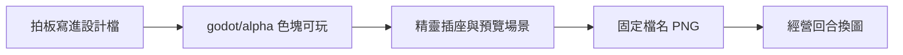
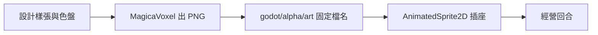

# Alpha 計劃

- 此檔是 Alpha 的實作順序與拍板數值
- 工程路徑（歷史）：曾規劃 `godot/alpha`；實作為 `godot/alpha_v0_1`（**已凍結**）
- **v1.0 起活線：** `godot/game`（見 `docs/versioning.md`）
- 已發佈的 Demo（`godot/demo_v0_*`）與 Alpha 保持不動
- 長線設計仍以 `docs/systemdesign/` 為準；本檔補上缺口清單裡尚未寫進系統檔的決定
- 缺口對照：`docs/systemdesign-gaps.md`（2026-10-21）
- Alpha 才設計的題：`docs/alpha/design.md`
- 技術設計審查（可持續開發／效能／Steam·Switch·Xbox；§6 已勾完）：`docs/alpha/tech-review-v0.1.md`
- 已落地項對照：`docs/alpha/implementation-status.md`
- 主機商務／Godot 釘版：`docs/alpha/console-business.md`、`docs/alpha/godot-middleware-pin.md`
- 字串表／字型／匯出：`docs/alpha/i18n.md`、`docs/alpha/fonts-subset.md`、`docs/alpha/export-presets.md`

# 版本目標

先把剩餘 P0、全部 P1、全部 P2 做成可玩系統，畫面暫時沿用色塊。系統清單能從準備回合打完一日之後，才把 Voxel 圖接進遊戲。

Alpha 的畫面與效果集中在美術。設計與建模不改玩法腳本。玩法維持 Godot 2D、俯瞰跟隨、橫向手機網頁。Voxel 用 MagicaVoxel 以固定 3/4 俯瞰渲成精靈，再換掉色塊。

# 順序

1. 把下面的拍板數值寫進對應 `docs/systemdesign/` 檔（缺整份的系統另開新檔）
2. 在 `godot/alpha` 用色塊做完可玩系統
3. 工程做一次精靈插座與預覽場景
4. 設計與建模按檔名交 PNG
5. 同名圖覆蓋後，經營回合換上 Voxel；HUD 只換皮

# 拍板數值

以下數字供程式直接使用。價格表仍用 `docs/systemdesign/stockpricesystem.md`。能力換算仍用已拍板的 STR／AGI／INT 表。

## 資金與經營值（P0）

- 起始資金 600
- 準備回合採購按箱扣成本。資金不足不能買。不允許買到負數
- 關店：商店資金加上當日營業額。被偷金額不入帳
- 當日營業額低於當日採購支出時，結算標為虧損。遊戲不因此結束
- 經營值與資金分開。關店 +10；每成功收銀 +2；每生氣離開 −3；每抓住小偷 +5；每被偷一件 −1
- 經營值用於解鎖新貨、擴店。雇員工資與傢俬增購用資金

新檔：`docs/systemdesign/economysystem.md`。

## 準備回合（P0）

關店後進入準備選單。操作沿用 `docs/systemdesign/control.md` 的選單鍵。畫面分頁：

1. 能力配點
2. 技能與奧義裝備
3. 外觀（色塊階段只改色；Voxel 接上後才換模型）
4. 採購
5. 開發新貨（花經營值）
6. 擴張與貨架擺放
7. 店員

然後開始下一日。

新檔：`docs/systemdesign/prepphase.md`。

## 級數（P1）

- 上限 20
- 每級 2 點，自由分配到 STR／AGI／INT。單項仍以 50 封頂
- 升到下一級所需經驗 = 80 × 當前等級
- 當日經驗 = 20 + 成功收銀×4 + 抓住小偷×8 − 生氣離開×6 − 被偷件數×2。最低 0
- 2 級起每 2 級解鎖一招現有技能。不新增技能。解鎖表寫進 `playerlevel.md`

## 客人流量（P1）

長線取代 Demo 的每 5 秒 1 人、在店 15 人：

- 生成間隔 10–15 秒
- 在店上限 10。每擴一區 +3。硬頂 18
- 找不到貨 +15（思考 3 秒、該件移到清單最後，規則不變）
- 三類客人：普通移速 1.0、趕時間 1.25、慢客 0.75。權重 70／15／15
- 客人移速仍獨立於玩家 AGI，基值相當於 AGI 10

## 污物與小偷流量（P1）

污物：

- 開局 1 處，之後每 18 秒 1 處，同時最多 4
- 垃圾：玩家每秒 −6 氣力
- 客人不滿每秒：垃圾 +3、水漬 +6、嘔吐物 +12
- 移速 ×0.5、水漬滑倒、嘔吐物禁技能與能力 ×0.7，維持現有規則

小偷：

- 營運開始後 20 秒出現第一個，之後每 40 秒嘗試一次，同時最多 1
- 清單 1–3 件
- 霸王色：該次生成有 50% 取消。基礎出現率是每次嘗試 100%

## 衝刺撞飛與擁擠（P1／P2）

撞飛購物客人的不滿：

- 空手 +25
- 身上沒有該客人要的貨 +40
- 身上有部分所需 +0
- 身上有齊該客人全部所需：不滿歸 0
- 禮貌衝撞：以上不加。齊貨仍把不滿歸 0
- 小偷撞飛：飛離商店，贓物遠距散落可撿（不計被偷；**算抓住**；見 `thiefsystem.md`）

擁擠：

- 玩家周圍 2 身位內客人達到 4 人：移速 ×0.75，並冒出「唔該借借」
- 與客人重疊：移速 ×0.85

凌波微步只忽略這三個移速懲罰：污物 ×0.5、擁擠 ×0.75、穿過客人 ×0.85。不免疫滑倒、垃圾扣氣、嘔吐物禁技能與能力下降。

輕放與長按的分界是 180 毫秒。

## 兩招未完成奧義（P1）

Yes! My Lord!：

- 只作用於非小偷、非離開中的客人
- 期間每 0.5 秒從最近的有貨貨架取 1 件。原訂購買件數作廢。清單總數仍最多 15
- 未解鎖 SKU 與空貨架跳過，改下一個最近貨架
- 時間結束後仍要排隊。指令與 Circle 照付已取貨物
- 沒取到貨的人不強制去收銀

全體集資：

- 不含小偷、不含已在離開的客人
- LV1：目前在任一收銀台排隊的人
- LV2：符合資格者先排已在排隊的，其餘按離收銀機由近到遠。取 ceil(人數/2)
- LV3：全部符合資格的人
- 只結已拿在身上的貨。清單上未取到的不算錢、不扣架
- 略過指令與 Circle。金額全額入當日營業額
- 結完後離開

## 店員（P1）

- 可雇 NPC。不是玩家本體
- 每日開始扣工資 40
- 人數不大於收銀機數
- 每人指定一個崗位：補貨或收銀
- 補貨：到補貨點取與該架同種類的一箱，上架用 AGI 10 的 Circle
- 收銀：只處理自己那台。不玩方向指令。Circle 用 INT 10 的秒數
- 導出角色佔一個雇員欄，使用導出的 STR／AGI／INT，工資仍付

新檔：`docs/systemdesign/clerksystem.md`。

## 幫忙取貨與 COMBO（P1）

- 客人處於找不到貨時，玩家對準按行動，接下該件代取
- 玩家從貨架或補貨點取得該 SKU 後，再對準客人按行動交付
- 一次交付涵蓋該客人剩餘清單、而且件數達到 3：COMBO。不滿 −40。該單營業額 +20%
- 單件交付只消該件，沒有 COMBO

新檔：`docs/systemdesign/fetchcombo.md`。

## 店面、冰櫃、多台收銀（P1／P2）

- 沿用 20px 格
- 初始店面與 v0.5 相同：收銀 1、乾貨架 3、凍櫃架 3、冰櫃架 0、補貨點 2
- 擴張花經營值，一次加寬一側。最多 2 次
- 準備回合在網格上擺收銀機、貨架、冰櫃、補貨點。不可重疊、不可擋門
- 增購用資金：收銀機 200，上限 3 台；貨架 80，每類上限 6
- 貨架品質容量 8／12／16。初始為 12
- 雪糕、凍肉、叮叮飯只能放冰櫃。上架後 90 秒現實時間未賣出則腐壞消失，不入帳
- 多台收銀：客人排人數較少的一隊。玩家要站在該台後方才可收銀。隊伍不交叉

新檔：`docs/systemdesign/storelayout.md`。

## 劇情與事件（P1）

事件是規則修改器加結算文字，不做大地圖動畫。

- 1 級：教學。成功收銀 3 人即標記完成。當日仍打完
- 3 級：當日趕時間客人加權
- 5 級：被偷 0 且生氣離開不多於 2，額外經營值
- 8 級：冰櫃貨開賣
- 12 級：當日小偷生成間隔減半
- 16 級：出現清單 8 件的客人。COMBO 成功才有額外結算
- 失敗：當日生氣離開達到 10，當日經驗為 0，劇情不推進。可重試當日。資金與已採購的貨保留

新檔：`docs/systemdesign/eventsystem.md`。

## 掉落、清潔起手、小偷與世界規則（P2）

- 地上的箱只有玩家能撿。客人不撿、不算進清單。小偷把貨帶離店才計被偷
- 清潔與打擊可以在走路時起手。計量或連打一開始，角色停止移動
- 小偷踩污物，移速與客人同一套額外效果
- 小偷不被安撫、不被金屬狂潮影響、不佔在店客人上限
- Yes! My Lord! 與全體集資都不包含小偷

## 收銀方向（P2）

四個方向均勻抽取。可以連續重複。

## 介面、存檔、導出（P2）

- ~~暫停：世界與玩家都停；繼續／放棄當日~~ **已做**（`pausemenu.md`；營運日 Esc／Start／手機「暫停」）
- ~~事件 SFX 開／關與聲量~~ **已做**（暫停選單；`SfxBus`；跨局 `user://settings.cfg`）。BGM／完整設定頁仍未做
- ~~存檔寫入本機 `user://save.json`。關店與準備回合結束時各寫一次~~ **已做**（長線見 `docs/systemdesign/savesystem.md`；活線 `godot/game`）
- ~~輸入改 InputMap action~~ **已做**（長線見 `docs/systemdesign/control.md`；Autoload `Controls`）
- 教學：首日三條提示，分別指向執貨、收銀、清潔（**未做**）
- 技能演出開始後 0.45 秒內不接受移動與技能。之後恢復操作。奧義演出為 0.7 秒（**未做**）
- 導出寫出本機 JSON：名字、STR／AGI／INT、已解鎖技能與等級。匯入後佔一個店員欄。不做連線（**未做**）

## 用詞（P2）

寫回原設計檔，不改規則：

- 「以為」改為「以下」
- 「三能種力值」改為「三種能力值」
- 奧義「技令」改為「指令」
- 衝刺撞飛那段補完斷句
- 攜帶清單寫明是堆疊：後取先上。去掉 FILO 與跳號例子

# 可玩里程碑

每一段都要能在色塊畫面上打完該段新增的路徑。

1. 規則補丁：收銀方向、180 毫秒長按、清潔與打擊起手、掉落歸屬、小偷與污物及技能的關係、擁擠、撞飛不滿、凌波微步、長線流量、霸王色、用詞修正
2. 資金、經營值、虧損標記、存檔、暫停、關店勝敗
3. 準備回合各分頁（外觀先用色塊）
4. 網格擺放、貨架容量、冰櫃腐壞、多台收銀
5. 店員崗位、代取與 COMBO、三類客人移速
6. 經驗、升級、技能解鎖、六個事件、失敗重試
7. Yes! My Lord!、全體集資、角色導出 JSON

系統清單完成的標準：能從準備回合採購、擺放、雇員，打完一日，其中有雙收銀台、污物、小偷、冰櫃、COMBO，並且存檔。然後才把 PNG 接進經營回合。

# 美術怎樣接進遊戲

設計和建模不改玩法腳本，也不在 Godot 裡擺店。他們交色盤、樣張和 PNG。工程先做一個插座，檔案放對名字就換上。

現在 v0.5 的人、架、污物是腳本裡的 `Polygon2D`。玩家在 `godot/demo_v0_5/scripts/demo.gd` 的 `_make_player` 畫成 26×26 綠塊，狀態靠 `player.gd` 改顏色。碰撞箱是另一個 `RectangleShape2D`。換圖時碰撞、鏡頭 zoom 1.22、虛擬鍵位置保持不動。尋路格仍是 `pathfinder.gd` 的 20px。

## 插座（工程做一次）

系統清單完成、正式鋪美術之前，在 `godot/alpha` 加這層：

- 目錄 `art/`。每個會動的物件用 `AnimatedSprite2D`，動畫名稱寫死。PNG 還沒到就繼續顯示色塊，所以可以一張一張換
- 場景 `scenes/art_preview.tscn`：空店、鏡頭 zoom 1.22、只顯示已交的圖。設計和建模開這個場景按播放來看大小，不開經營回合腳本
- 貼圖匯入：Filter 關（Nearest），像素保持硬邊
- 角色腳底對準節點原點。碰撞維持約 26×26

動畫名稱（四向：`s` 下、`n` 上、`e` 右、`w` 左，對 WASD）：

- 玩家：`idle_*` `walk_*` `run_*` `dash_*`，以及 `slip` `down` `clean` `fight` `checkout`
- 客人：`walk_*` `idle_*` `angry` `leave`。普通、趕時間、慢客用三個模型，不用整身改色
- 小偷：`walk_*` `idle_*` `fight` `fly`
- 店員：`walk_*` `restock` `checkout`
- 貨架：乾貨、凍櫃、冰櫃各 `fill_0` 到 `fill_3`
- 污物：`trash` `water` `vomit`
- 貨品：9 個 SKU 小圖，約 16px
- 特效貼圖：`suck` `spray` `coin` `combo` `timestop` `clean_spark` `skid`。掛在已有事件上（執貨吸入、上架噴出、收銀、技能 zoom、時停、清潔、滑倒）

## 設計交什麼

交到 `art/ref/`：

- 一張店內樣張，角度跟遊戲同一台 3/4 俯瞰
- 32 色以內的色盤（MagicaVoxel 調色盤）
- 每個動畫幾格（走路 4 格、衝刺 2 格即可）
- 手機橫向驗收：在預覽場景裡，玩家、客人、小偷、店員的頭型要分開；污物要能跟地板分開

## 建模交什麼

工具用 MagicaVoxel。所有物件用同一台鎖定相機渲染。

- 源檔：`art/src/player.vox` 這類
- 圖：透明背景 PNG。檔名等於動畫名加格號，例如 `art/player/walk_s_01.png`
- 角色大約 16 voxel 高，輸出大約 32×40 像素
- 傢俬對齊 20px 格的倍數
- 覆蓋同名 PNG 就換上，不用改腳本

## 接線順序

先接玩家一條 `walk_s`，在預覽場景對過大小和腳底。角度不對就只改相機，不重雕全套。通過後才做地板、貨架、9 種貨、客人、小偷、店員、污物，最後特效。HUD 只換皮，觸控區不動。

美術組在店員和冰櫃可玩之後，可以先做樣張和主角模型，只放在 `art/ref` 和 `art/src`。正式把 PNG 接進經營回合，要等上面的系統清單完成。

# 本階段不做

- 把 Demo 各版改成 Voxel
- 改成 3D 場景
- 新增技能
- 連線對戰或即時同步導出
- 音效與音樂
