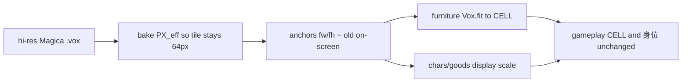

# Voxel 高解析度升模計劃（畫面尺寸不變）

- **拍板：** 1A＝店內視覺身高／佔格大致不變；2＝角色＋傢俬／貨品全庫升 Magica 解析度  
- **不做（本輪）：** C 路線 3D rig／執行期 Skeleton3D；改技能身位公式  
- **活線：** `godot/game`

## 目標與凍結合約

| 凍結（不要為升模而改） | 變更（美術源＋烘圖） |
| --- | --- |
| `GameState.CELL = 64` 格點 | Magica 體素密度大幅提高 |
| 傢俬 footprint（tile 數） | `tile_voxels` 16 → **128**（×8） |
| `Tuning.BODY_LENGTH = 26`、技能半徑（×身位） | 人物包絡約 **100×40×130**（設計師目標；腳 z=0、臉 +Y） |
| 碰撞 26×26／22×22 | Bake 有效解析：令 `128 × PX_eff ≈ 64` |
| HUD `SkuIcons`（非 voxel） | 程序肢體區改為**比例化**或改交 Magica 幀包 |

## 新 Magica 尺寸表（相對舊稿 ×8）

| 類 | 舊（約） | 新（約） |
| --- | --- | --- |
| 一格地板 | 16×16×? | **128×128** |
| 人物 | 12×10×20 | **~100×40×130**（可略偏；寬高比由美術定） |
| 乾貨架 2×1 | 32×16×18 | **256×128×144** |
| 補貨架等 | 按舊 footprint ×8 | 同比例 |
| 貨品／箱 | ~8³ | **~64³** 級 |

軸向不變：X 右、Y 前、Z 上；腳底 z=0；角色臉 +Y。

## Bake／顯示策略（選定）

1. **世界：** 繼續 `CELL=64`；`tile_voxels=128`。  
2. **烘圖：** `PX_bake = 1`（整數像素），再 **nearest 縮到 `DISPLAY_SCALE = 0.5`**（因 128×0.5=64），或等價地在 `Vox.sprite`／`animated` 套 `scale *= 0.5` 且 anchors 寫「顯示用」fw/fh。  
   - 傢俬：維持 `_fit_body` → `Vox.fit` 進格點矩形（已自適應）。  
   - 角色／地上箱／多數 1:1 精靈：統一 display scale，使約 100 寬 → 螢幕約 50px 寬（近舊 48）。  
3. **不採用** 維持 `PX=4` 再 scale 0.12（PNG 過大、import 過重）。  
4. **Cartoon：** outline／posterize 在高解 bake 後、downscale 前做；或 downscale 後再 1px 墨線（擇一鎖死，避免雙重線）。

## 影響清單

### 高（必改）

| 區 | 路徑 | 要做 |
| --- | --- | --- |
| Bake | [`tools/voxel_sprites.py`](../../tools/voxel_sprites.py) | `PX`／tile 常數；anchors；可選 downscale |
| 動作 | [`tools/voxel_character_anims.py`](../../tools/voxel_character_anims.py) | 肢體區改 `sx/12` 比例，或高解角色**停用**程序姿、改 `art/src/anim/` |
| 模板 | [`tools/voxel_blockout.py`](../../tools/voxel_blockout.py) | 新尺寸脚手架（勿覆寫設計師 `.vox`） |
| Props | [`tools/voxel_alpha_props.py`](../../tools/voxel_alpha_props.py) | fill／dirt／fx 體積隨新單位 |
| 目錄 | [`godot/game/art/catalog.json`](../../godot/game/art/catalog.json) | `tile_voxels`、各 size |
| 執行期 | [`voxel_sprite.gd`](../../godot/game/scripts/voxel_sprite.gd) | `DISPLAY_SCALE` 或 fit 角色目標框 |
| 地板 | [`floor_tiles.gd`](../../godot/game/scripts/floor_tiles.gd) | 硬編碼 `TILE_AX/AY` → 改讀 anchors |
| 持箱 | [`box_stack.gd`](../../godot/game/scripts/box_stack.gd)、[`dropped_box.gd`](../../godot/game/scripts/dropped_box.gd) | 固定 32×28／0.65 scale 重校 |
| Look | [`prep_menu.gd`](../../godot/game/scripts/prep_menu.gd) | 預覽 `scale=2` 重校 |
| 美術源 | `art/src/**/*.vox` | 全庫重模或升採樣（角色＋傢俬＋貨） |
| 文件 | [`voxel-v0.1.md`](voxel-v0.1.md)、[`voxel-cartoon-shading.md`](voxel-cartoon-shading.md)、[`animation-v1.0.md`](animation-v1.0.md) | 改尺寸／px 敘述 |

### 中（抽樣重校偏移）

硬編碼 Y 偏移（crowd 氣泡、loading circle、shelf 貨圖、restock icon、float text 等）：若顯示身高仍近舊值，多數可不動；升模後目視抽樣再調。

### 低（刻意不動）

| 區 | 原因 |
| --- | --- |
| `CELL`、傢俬 footprint、開店檢查 | 世界合約 |
| `BODY_LENGTH`、skills／cannon／self_checkout 半徑 | 身位≠精靈高度 |
| `sku_icons.gd` HUD | 非 voxel |
| 傢俬 `_fit_body` 路徑 | 已 fit 到格 |

### 技能／設定／環境

- **技能：** 數值與距離不改；只驗「精靈變細緻後」瞄准／讀圖是否仍清楚。  
- **設定／存檔：** 無新欄位；舊存檔擺設仍合法。  
- **環境：** 地板／牆／門隨新 tile 重烘；縫線用 anchors 對齊。  
- **多人：** 無協定變更（仍是同一套 PNG id）。

## 分刀實作

| 刀 | 內容 | 驗收 |
| --- | --- | --- |
| **0** | 本文件＋凍結合約寫入 `voxel-v0.1.md` 草案段 | 團隊同意 T=128、DISPLAY_SCALE |
| **1** | Bake：`tile_voxels`、PX／downscale、anchors；用 **1 角色 + 1 貨架 + 1 地板** 樣張 | 格仍 64；角色寬≈舊；fit 貨架不爆格 |
| **2** | 肢體姿比例化或改幀包優先；`test_character_anims` | walk／idle 不裂肢 |
| **3** | Runtime：`voxel_sprite` scale、`floor_tiles`、box／Look | 店內走一圈無飄地板／巨箱 |
| **4** | 美術全庫換稿（或工具升採樣占位）＋全量 rebake＋import | 合約測試綠 |
| **5** | 文件與 cartoon「4px／voxel」敘述更新；偏移微調 | 簽核樣張 |

## 風險

- **100×40×130** 與 tile×8 人物寬（96）不完全一致 → 允許人物包絡獨立，只要 display 對齊舊螢幕寬。  
- 程序肢體姿在高解上易壞 → 高解角色以 Magica 幀為主。  
- PNG 量：PX=1 的 128 格仍大於舊 PX=4×16；需接受 import 變慢，禁止 PX=4 直出。  
- 勿對 `art/src` 跑會覆寫的 blockout 全量。

## 非目標

- 改碰撞／技能身位去「跟著精靈變高」  
- 執行期 3D  
- 只升玩家、傢俬維持舊 16（已否決；本計劃全庫）
