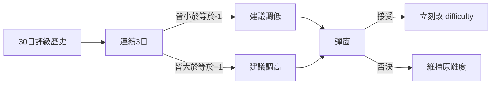

# 難度系統（stub）

- 此檔是**整體難易度**長線占位；數值表未定，先定介面與和評價的銜接
- 拍板介面：2026-11-08（與 `ratingsystem.md` 同期）
- 工程活線：存檔 `difficulty`＋連續 3 日評級**建議彈窗**已接（`prep_menu.maybe_offer_difficulty_prompt`）；**尚未**改客人／小偷／污物／EXP 數值。現有準備頁 **簡易／普通** 仍為測試版（見下）

# 目標概念

- 遊戲有**整體難度**，玩家可隨時在準備回合調整（日後可加設定頁）
- 以**普通**為基準
- **簡易**：營運較易（客人要求、小偷率、污物率等調低；細節表 TBD）
- **困難**：營運加難，但 **EXP 與資金有加成**（倍數 TBD）

# 與評價的銜接（已拍板）

觸發（見 `ratingsystem.md`）：

- 連續 **3 日**日結評級 **≤ −1** → 建議**調低**一檔（若已在最低檔則只提示、無更低可選）
- 連續 **3 日**日結評級 **≥ +1** → 建議**調高**一檔（若已在最高檔則只提示）

彈窗：

- 說明建議方向與當前／目標檔
- **接受** → **即時**寫入存檔難度並生效於下一局營運（若仍在準備則下一次開始營運）
- **否決** → 不改難度
- 否決後同一「連續 3 日」窗口不重複煩（清 streak 或記 `difficulty_prompt_acked`；實作二選一，預設：**該 streak 已處理則不再彈，直到 streak 斷開再累積**）

評價**不**因難度自動正規化（簡易下較易拿高評屬預期；日後若要公平係數另案）。

# 檔位（占位）

| 檔 | 營運壓力（TBD） | 報酬（TBD） |
| --- | --- | --- |
| 簡易 | 客人要求／小偷／污物等較鬆 | 無加成或微幅（未定） |
| 普通 | 基準 | 基準 |
| 困難 | 較緊 | EXP／資金加成（未定） |

具體倍率、清單件數、生成間隔等**未拍板**，落地前不得當活線常數。

# 與現行測試難度的關係

- `storepreparationphase.md` §8：**簡易／普通**二選一，僅 `ProductVersion.TEST_TOOLS`；**不寫入存檔**；正式版隱藏並強制普通
- 正式難度落地後：
  - 存檔欄 `difficulty` ∈ { easy, normal, hard }
  - 測試 Easy 鈕可**移除**，或映射到正式「簡易」並改為寫檔（實作時二選一，預設：**合併進正式簡易**）
- 在正式三檔未實作前，評價系統的「建議改難度」彈窗可先做 UI／log stub，或等本檔數值齊再接

# 存檔

- 店主檔：`difficulty`（預設 `normal`）
- 變更時機：準備頁手動改；評價建議彈窗接受時

# 未定（勿當已拍板）

- 各檔對小偷率、污物、不滿、清單件數、客人流量的精確表  
- 困難的 EXP／資金加成數字  
- 是否允許營運中途改難度（預設：**否**，僅準備回合）  
- 線上房：以 Host 難度為準（訪客跟房；訪客自己店難度獨立）— 與評價 Host 歸屬一致，細節隨連線里程碑補
