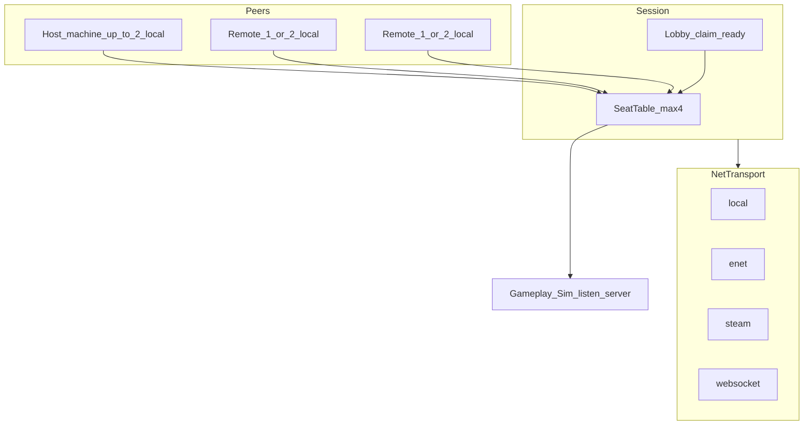

# 多人連線設計報告（本機二＋線上補滿至四人）

- **狀態：** 設計草案；**M1 本機雙人已落地**（`SeatTable`／`InteractLock`／`SessionService`）；M2 RPC／NetTransport 尚未實作；§10 企劃項已於 2026-11-05 拍板
- **範圍：** 本機合作、線上合作、以及兩者混合的同一 Session 模型；技術分層與平台差異
- **產品錨點：** 活線 `godot/game`（Godot 4.7）；版控見 `docs/versioning.md`
- **對照：** `docs/alpha/tech-review-v0.1.md`、`docs/systemdesign/ecosystem.md`、`docs/systemdesign/playerexport.md`、`docs/systemdesign/control.md`、`docs/systemdesign/savesystem.md`、`godot/game/scripts/platform_services.gd`
- **產出／更新：** 2026-11-05（初稿＋§10 拍板）；同日晚間定稿 **M1 本機雙人**（§11）

---

## 1. 摘要

| 項目 | 建議決議 |
| --- | --- |
| 主目標 | **同一對局：** 本機最多二人，並可再加入線上玩家，**全房操作座位最多四人** |
| 房間硬上限 | `room_max_seats = 4` |
| 每機本機上限 | 桌面／Steam／LAN：`per_peer_max_local_seats = 2`；**Web：每機 1 seat** |
| 權威 | Listen-server（房主跑完整模擬）；client 只送**輸入意圖** |
| 核心模型 | **Seat ≠ Peer**：一個連線可佔 1～2 個 seat（Web 僅 1）；協定以 `seat_id` 為準 |
| 結算 | 經驗加總平分；當日營業額同等入 Host 店與各訪客本店資金 |
| 職能／觀戰 | 四人全技能；**不做觀戰** |
| 引擎方案 | Godot High-level Multiplayer（`@rpc` + 可替換 `MultiplayerPeer`） |
| 後端 | 四人小房；**不必** MMO／專用叢集。Steam 用平台網路；Web 用自架房間／中繼 |
| 跨平台互通 | v1 **不**承諾 Steam↔Web↔主機互通 |
| 最大風險 | 同店即時需重構模擬權威與多 seat 輸入；不是選哪家雲 |

一句話：**純本機雙人、純線上四人、本機二再線上補位，共用同一套 SeatTable；傳輸可換，玩法不綁死 peer 實作。**

---

## 2. 現況與落差

### 2.1 已有（對多人有利）

- 單一活線工程；平台差異走匯出預設 + `PlatformServices` + feature flag（見 `docs/versioning.md`）
- `PlatformServices`：存檔／掛起／UI profile（`touch`｜`gamepad`｜`tv`）
- InputMap + Autoload `Controls`；手把不寫死 device 0（見 `control.md`）
- 暫停／掛起 checkpoint（見 `pausemenu.md`）
- 匯出：Web → Pages；Win／Linux Steam 候選（尚未接 Steamworks）

### 2.2 缺口

- 無 `MultiplayerPeer`／`@rpc`／大廳程式碼
- 模擬與輸入高度耦合於大型腳本（經營主控、`player.gd` 等）
- `ecosystem.md` 假設「每個商店只有一位玩家角色」
- 角色導出為本機 JSON、不做連線（`playerexport.md`；Alpha plan 亦列「連線對戰或即時同步導出」不做）
- Web 無法使用裸 ENet UDP
- 主機線上涉及 SDK／認證／商務，遠晚於 Steam／Web
- tech-review 原評估「單機較易過認證」— 上線上會擴大 Switch／Xbox 範圍

### 2.3 本報告不涵蓋

- 換引擎
- 40+ 人對戰／競技 rollback netcode
- v1 承諾跨發行平台全互通
- 本機三～四人或四分割螢幕作為上架賣點

---

## 3. 人數與混合座位模型

### 3.1 硬約束（建議拍板）

| 常數 | 值 | 說明 |
| --- | --- | --- |
| `room_max_seats` | 4 | 全房操作座位上限 |
| `per_peer_max_local_seats` | 2（桌面／Steam／LAN）；**1（Web）** | 任一客戶端機器最多本機座位 |
| `claim_seats` | 1 或 2（Web 僅 1） | 加入／開房時宣告；`current + claim ≤ 4` 否則拒絕 |

- 一機兩座位＝兩套 device 綁定（手把／鍵鼠），**不是**分屏四人；Web 不做本機二。
- 大廳階段可開放線上補位；**開日後不允許中途加入**（見 §10）。

### 3.2 允許的房間組成

| 組成示例 | Seat 分配 | 說明 |
| --- | --- | --- |
| 本機 2 | 同機 seat×2 | 線上 peer＝0；仍走 Session，`transport` 可為 `local` |
| 本機 2 + 線上 2 | Host 佔 2；兩名 remote 各佔 1 | **主打混合目標** |
| 本機 2 + 線上 1（對方本機 2） | 兩機各 2 | 總座位 4；雙方都是雙人沙發 |
| 線上 4×1 | 四機各 1 | 經典連線合作 |
| 本機 1 + 線上 1～3 | Host 1 + remotes | 單人開房等人 |

### 3.3 Seat ≠ Peer

```text
Peer (一條連線 / 一台邏輯客戶端)
  └─ 擁有 1～2 個 Seat
        └─ 各對應一個可控角色（四人全技能；不做觀戰座位）
```

- RPC／輸入意圖一律帶 **`seat_id`**，禁止假設「一人一 peer」。
- Host 本機座位可短路進模擬（不必出網）；遠端座位由擁有該 seat 的 peer 上送意圖。

### 3.4 SeatTable 欄位最小集

| 欄位 | 說明 |
| --- | --- |
| `seat_id` | 0～3 |
| `owner_peer_id` | 擁有此座位的 peer |
| `local_index` | 該機第幾手（0 或 1） |
| `ready` | 大廳就緒 |
| `role_flags` | 預留；v1 一律完整操作（不做觀戰） |

---

## 4. 產品模式

多人不是單一功能。建議同一 Session 掛不同對局模式；**混合座位涵蓋純本機與純線上**。

| ID | 模式 | 體驗 | 同步難度 | 與主目標關係 |
| --- | --- | --- | --- | --- |
| **A** | 同店即時合作 | 最多 4 seat 同一店鋪經營 | 極高 | **主路徑**；混合座位服務此模式 |
| **B** | 本機分控 | 同機 1～2 seat，`transport=local` | 中 | A 的零延遲切片；可再掛線上補位 |
| **C** | 異店並行／競賽 | 最多 4 人各開一店比分數 | 低～中 | 附加；可較早驗證 Session |
| **D** | 非即時幫手 | 導出角色當店員（線上化傳輸） | 低 | 附加；滿足不了「開一局四人」 |
| **E** | 觀戰／受限座位 | — | — | **不採用**（見 §10） |

### 4.1 建議採納路徑

1. Seat 協定與混合模型定稿（本文件）
2. 本機 2 seat + SeatTable（`transport=local`）可開一局
3. **同一協定**下 LAN／ENet 加入第 3、第 4 seat（驗收「本機二＋線上補位」）
4. Steam lobby／peer 換上同一 Session
5. Web backend（見 §7；**每機限 1 seat**）
6. 主機：單機或同平台後期；不阻塞上列

並行可選：C 或 D（不阻塞 2～3）。

### 4.2 備案房型

**不啟用觀戰備案。** 同店最多 4 個完整操作座位。

---

## 5. 同店規則（混合特有）

### 5.1 鏡頭與 UI

- **不做**四分割。
- 本機二（及日後同機多 seat）：單鏡頭**永遠跟隨在場可控角色的中點**；**不做**焦點切換。全地圖模式仍鎖店中心（見 `control.md`）。
- HUD：各 seat 可見**個人 COMBO**；另顯示**全隊 COMBO**（見 §11）。
- 遠端玩家（M2+）：世界標記／簡易指示；不要求本機螢幕為每人獨立鏡頭。

### 5.2 互動衝突（已拍板）

- **物件鎖定：** 先觸發的玩家處理某物件時，其他玩家**不能**對同一物件互動，直到該互動動作完結。M1 動作級 L／N 表見 **§11.6**。
- **COMBO：** **個人 COMBO**（僅該 seat 自己的連段）＋**全隊 COMBO**（任一 seat 達標都可接棒推進）。HUD 同時顯示兩者（§11.7）。

### 5.3 職能

**四人全技能**（含奧義）；不做受限店員位／觀戰座位。每 seat 用**自己角色檔**的 STR／AGI／INT、裝備技能／奧義；各自手上貨堆與 CD。

### 5.4 進度、存檔、經驗（已拍板）

- **經驗：** 營運中事件經驗先記入**觸發該動作的 seat 角色**；日結把當日全員獲得加總後**平分**寫回各參與角色進度。
- **資金／營業額（線上訪客有自己的店時）：** 當日營業額**同等發給** Host 店與每位訪客本店資金。
- **本機雙人例外（M1）：** P2 角色**無店舖進度** → 營業額／店資金**只進 Host（P1）店**；P2 只更新角色經驗（平分後）。見 §11.7。
- **評價（設計見 `ratingsystem.md`）：** 營運點與**商店評價只算 Host 店**。線上訪客自己店的商店評價**不**因支援 Host 而改；訪客角色另累積 **支援別店評價**（日結 `+=` 該局 Host 評級，可為負）。本機 M1 訪客槽同樣記支援別店評價。
- 與現行 `ecosystem.md`「一店一主角色」→ 已加 coop 註記；訪客槽存檔見 `savesystem.md`。

### 5.5 暫停

- **本機（M1）：** 任一 seat 的 Esc／Start／暫停鈕都可開／關暫停；結束本日與選單共享。
- **線上（M2+）：** 僅 **host 機**可觸發全房暫停；client 見遮罩。
- 對齊掛起／`PlatformServices` checkpoint；日結寫檔依 §5.4／§10／§11。

### 5.6 斷線與補位（已拍板）

- **大廳（未開日）：** peer 斷線 → 釋放其名下 seat，可再被他人 `claim`。
- **開日後斷線：** 該玩家角色**移除**，進度／結算相關狀態**凍結至日結**；**座位中途不可再被佔用**。
- **中途加入：** 不允許。
- Host 離開：v1 可解散整房；介面預留 host migration，不必首版實作。

### 5.7 大廳流程

1. Host 選本機玩家人數 **1｜2**（Web：**僅 1**）→ 開房（本機雙人細節見 §11）  
2. UI 顯示剩餘名額（`4 - occupied`）  
3. Join 端選加入為 **1｜2** 人（受剩餘名額與 `per_peer_max_local_seats` 限制；**Web 限 claim 1**）  
4. 全員 `ready` → 開日（之後不可再加入）  
5. 純本機雙人：§11；之後「邀請線上」＝掛上真實 peer，**不重寫玩法**

---

## 6. 技術架構

### 6.1 分層（對齊既有 PlatformServices 原則）

```text
Gameplay / Sim（權威世界）
        ↑ 只認 seat 輸入與權威結算
Session / Lobby / SeatTable
        ↑ 開房、claim、ready、開始日、斷線釋放
NetTransport（MultiplayerPeer 實作）
        ↑ local / ENet / Steam / WebSocket / 後期主機
PlatformServices（已有，旁路）
        ↑ 存檔、成就、UI profile、掛起
```



**禁止**在 `player.gd`／經營主控裡直接 `ENetMultiplayerPeer.new()`。玩法只呼叫 Session／InputRouter。

### 6.2 Godot 元件

| 元件 | 用途 |
| --- | --- |
| `MultiplayerAPI` + `@rpc` | 遠端呼叫；玩法對這層寫 |
| `MultiplayerPeer` | 傳輸可替換介面 |
| `ENetMultiplayerPeer` | 桌面／LAN／自架 listen 的 UDP 預設 |
| `WebSocketMultiplayerPeer` | Web 匯出（瀏覽器無裸 UDP） |
| `WebRTCMultiplayerPeer` | 可選 P2P；需 signaling；桌面要 GDExtension |
| `MultiplayerSpawner`／`Synchronizer` | 適合角色表現；**禁止**盲目複製整店庫存／客人 AI |

### 6.3 Transport 對照

| Backend | Transport | Session／身份 |
| --- | --- | --- |
| `local` | 假 peer／不開網路 | 同進程 seat；可稍後掛真 peer |
| `lan_enet` | ENet | IP:port 或 LAN browse；驗證混合補位 |
| `steam` | SteamMultiplayerPeer（GodotSteam 等） | Steam Lobby + 邀請 |
| `web_ws` | WebSocketMultiplayerPeer | 自架房間服務 |
| `console_*` | 平台 peer（後期） | 平台 session |

### 6.4 InputRouter

- 每機讀取最多兩套 device → 映射 `local_index` → 打上 `seat_id`。
- Host 擁有的本機 seat：意圖直接進 Sim。
- 遠端 seat：可靠／不可靠通道上送（見 §8）。
- 擴充現有 InputMap／`Controls` 時保留「不寫死 device 0」原則（見 `control.md`）。

### 6.5 概念 API（穩定抽象）

```text
INetTransport
  create_host(config) / join(address_or_ticket)
  get_peer() -> MultiplayerPeer
  poll() / close()

ISessionService
  create_room(local_seat_count) / join_room(claim_seats)
  seat_table / set_ready / start_run
  signals: peer_joined, peer_left, seats_changed, start_day, disconnect

InputRouter
  poll_local() -> Array[Intent]  # 每 Intent 含 seat_id
```

可選後期：`IIdentity`（顯示名／平台帳號）。

### 6.6 環境與運維（線上最小）

- 開發：本機雙視窗、LAN 兩～三機（一機開本機二）
- Staging：小 VPS（房間服務；Web 可選 relay／TURN）
- 正式：Steam 路徑可大幅減自建；Web 維持房間服務
- 監控：斷線率、RTT、`claim` 拒絕原因
- 主機：另案；不阻塞 Steam／Web

---

## 7. 跨平台一案

### 7.1 Feature flag（建議）

- `multiplayer_session`（Seat／Session 總開關）
- `net_local` / `net_enet` / `net_steam` / `net_websocket`
- Web 包：預設 `net_websocket`；**每機限 1 seat**（不做本機二）
- Steam 包：`net_steam`（可另留 `net_enet` 供 LAN 除錯）
- 主機：另 flag；預設可關線上

### 7.2 互通矩陣（產品真相）

| 組合 | v1 |
| --- | --- |
| 同機本機二 | 要（全平台可做輸入；主機 UI 另驗） |
| LAN 混合補位 | 要（桌面優先） |
| Steam↔Steam | 要（上架線上主路徑） |
| Web↔Web | 要（試玩／房間碼） |
| Steam↔Web | 不要（除非自有中繼專案） |
| 主機↔其他 | 不要（同平台後期另案） |

「一個方案」＝**同一 Session／Seat／權威模擬**；不是一個 UDP 連全世界。

### 7.3 與 PlatformServices 的邊界

- 存檔／掛起／成就／UI profile → 繼續只走 `PlatformServices`
- 開房／座位／傳輸 → **新建 Session 層**，不要塞進 `platform_services.gd`
- 與 tech-review「玩法只呼叫介面、後端可換」同一原則

---

## 8. 同店同步契約

### 8.1 Host 擁有

世界時鐘、客人／小偷／店員 AI、庫存與掉落、收銀結果、技能結算、營業額／經驗結算、Seat 角色權威狀態。

### 8.2 各 seat 擁有 peer 只送

輸入意圖：移動向量、action 按下／放開、技能選項、瞄準點等。  
**禁止** client 宣告「我撿了 N 件某某」。

### 8.3 分頻

| 通道 | 內容 |
| --- | --- |
| 不可靠／高頻 | 角色位置、面向 |
| 可靠／事件 | 互動、技能、結算、關店、Seat 表變更 |
| 不同步 | 客人 AI 內部狀態（host 跑；client 播表現） |

不要對整店實體上滿 `MultiplayerSynchronizer`。四人＝最多 4 路意圖 + 表現快照，模擬負載仍以店內代理為主。

### 8.4 安全

當輸入為不可信；校驗 seat 是否屬於該 peer、頻率限制、拒絕越權 `seat_id`。

---

## 9. 里程碑與驗收

| 里程碑 | 內容 | 驗收 |
| --- | --- | --- |
| **M0** | 本文件與 Seat 協定對齊 | 企劃／工程讀過；§10 已拍板 |
| **M1** | 本機 2 seat + SeatTable（`transport=local`） | **已交**（§11.9）；規格定稿 2026-11-05 |
| **M2** | LAN／ENet 第 3、第 4 seat | **本機二的 host 接受線上補位至 4**；開日後斷線移除角色、座位不可再佔 |
| **M3** | Steam lobby／peer | 同一 Session；好友邀請進混合房 |
| **M4** | Web `web_ws` | Web↔Web 房間；**每機 1 seat** |
| 並行可選 | 異店競賽或導出雲端 | 不阻塞 M1–M2 |

主機線上不列入上表臨界路徑。

---

## 10. 企劃拍板（原待確認項）

**拍板日：2026-11-05。** 下列為多人契約；改 `ecosystem.md`／相關長線檔於實作前另 PR。

1. **存檔／進度歸屬：** Host 與訪客都會更新**經驗**與**資金**。資金進 Host 店的店資金；訪客也更新**自己本店**的資金。（**本機 M1 例外：** P2 無店 → 資金只進 P1 店；見 §11.7。）  
2. **經驗與營業額公式：** 日結後，把當日所有人得到的經驗**加總平分**給參與玩家。線上資金：當日營業額同等發給每位訪客本店。本機見 §11.7。  
3. **職能限制：** **四人全技能**。  
4. **互動衝突：** 先觸發的玩家處理某物件時，其他玩家不能對該物件互動，直到該互動動作完結。COMBO 分為**個人 COMBO**與**全隊 COMBO**（細則 §11.6／§11.7）。  
5. **開日後斷線：** 角色**移除**並**凍結至日結**；座位**中途不可佔用**。  
6. **中途加入：** **不允許**。  
7. **Web 本機二：** **限每機 1 seat**。  
8. **觀戰備案：** **不啟用**。

---

## 11. M1 本機雙人規格（定稿）

- **狀態：** 設計定稿；**M1 已交**（第一刀＋第二刀，見 §11.9）
- **拍板：** 2026-11-05（本機身分／鏡頭／結算／輸入／鎖表／COMBO 等）
- **目標：** 同機 **2 seat** + **SeatTable**（`transport=local`），可打完一日營運；協定預留 seat_id 0–3 供 M2+。
- **非目標（仍排除）：** 網路、中途加入、觀戰、Web 本機二、準備回合雙人操作。外觀 Look 頁已開（店主；訪客槽帶各自 `skin_id`／`tint`，見 [`appearance.md`](appearance.md)）。

### 11.1 流程

1. **準備回合：** 仍單人（主存檔／P1 店主）。可管理訪客角色槽（見 §11.2）。
2. **開始營業前：** 選本機玩家人數 **1｜2**。選 2 時必須指定 P2 所用訪客槽（既有／複製主角色／新建空白）。
3. **營運日（補貨＋開店）：** 兩 seat 同時可控；共用 P1 店舖世界。
4. **關店結算：** 依 §11.7 寫 P1 店檔＋兩角色經驗；然後回準備（單人）。

### 11.2 訪客角色槽與複製

- 本機「訪客角色槽」清單，上限 **3**。
- 每槽只存**角色進度**（等級、經驗、能力、已解鎖／裝備技能與奧義等）；**無**店舖／資金／倉庫／擺放。
- 開雙人前可：**選既有槽**、**從主角色複製**成新槽（或覆寫所選空／目標槽——實作 UI 定）、**新建空白角色**。
- **複製：** 等級／能力／已解鎖與裝備技能／奧義／外觀（`skin_id`／`tint`／`unlocked_skins`）。不複製店舖與資金。外觀規則見 [`appearance.md`](appearance.md)。
- 存檔語意見 `savesystem.md`（JSON shape 實作時定）。

### 11.3 SeatTable（local）

| 欄位 | M1 用法 |
| --- | --- |
| `seat_id` | 0＝P1（Host／店主），1＝P2 |
| `owner_peer_id` | 單一 local peer（同進程） |
| `local_index` | 0 或 1（對應本機第幾手） |
| `ready` | 開日前選角完成即可；可簡化為開日即 ready |
| `role_flags` | 一律完整操作 |

- Intent／互動帶 `seat_id`；即使無網路也走同一套表，避免 M2 重寫。

### 11.4 輸入

- **預設綁定：** Seat0 → 手把 device **0**；Seat1 → 手把 device **1**。
- **鍵盤：** 可佔用**尚未被手把綁定**的 seat。當 seat0 與 seat1 **都已被手把佔用**時，鍵盤**不控制**任一角色（避免搶輸入）；拔掉一支手把後鍵盤可佔該空 seat。
- Action 集合與單機相同（`control.md`）；實作時按 device 過濾，不寫死「全局 InputMap 一人份」。

### 11.5 鏡頭、出生、碰撞、暫停

- **鏡頭：** 跟隨兩人中點；不做焦點切換。全地圖＝鎖店中心＋overview zoom。
- **出生：** 兩人皆在現行單機出生帶；Seat1 在 Seat0 旁偏移，避免重疊。
- **碰撞：** 兩玩家之間**軟碰撞**（輕推）；可幾乎貼身擠過窄道。
- **暫停：** 任一 seat 的 Esc／Start／HUD 暫停都可開／關；選單內「結束本日」兩人共享。

### 11.6 互動物件鎖（L＝鎖目標至動作完；N＝不鎖）

| 編號 | 動作 | 鎖定 |
| --- | --- | --- |
| A1 | 短按貨架取 1 件 | N |
| A2 | 長按上架 Circle | L（至 Circle 完） |
| A3 | 補貨點選貨／取貨 | L（選單／取貨結束） |
| A4 | 親身收銀 | L（整筆付完或取消重置） |
| A5 | 清潔 | L（計滿或放手重置） |
| A6 | 打擊小偷 | L（KO／失敗結束） |
| A7 | 親手交付 | L（交付結束） |
| A8 | 撿地上貨堆 | L（取完） |
| B1–B4 | 掉貨瞄準／腳邊丟／飛箱／命中 | N |
| C1–C4 | 移動／衝刺撞／踩污 | N |
| D1 | 自身／全店瞬發 buff | N |
| D2 | 範圍技能預覽中 | N |
| D3 | 範圍確認作用中 | L（對實際被交／被吸對象至結算完） |
| D4 | 塞貨／割韭菜等指定對象 | L（至結算完） |
| D5 | 掃地僧自動清污 | N |
| D6 | 奧義 | N |
| E1–E3 | 技能選單／暫停／鏡頭切換 | N |

規則摘要：先觸發且標 **L** 的動作持有該目標鎖；其他 seat 對**同一目標**的互動請求失敗直至鎖釋放。

### 11.7 COMBO、經驗、資金

- **個人 COMBO：** 只計該 seat 自己達成的連段；HUD 顯示自己的個人值。
- **全隊 COMBO：** 任一 seat 的交付／達標都推進同一條全隊連段（可接棒）；HUD 另顯示全隊值。
- **經驗：** 清潔／收銀／抓小偷等事件 XP 先記入觸發 seat；日結 `sum(各 seat 當日 XP) / 參與人數` 寫入各角色檔（M1 人數＝2）。
- **資金：** 當日營業額只加入 **P1 店**資金；P2 不收店資金（無店舖進度）。
- **評價：** 營運行為加減只進 **P1 店**營運點／商店評價；P2 日結寫入訪客槽 `support_rating +=` Host 評級（見 `ratingsystem.md`）。

### 11.8 技能與負重

每 seat 載入自己角色檔：STR／AGI／INT、裝備主動／被動／奧義；各自 carry 堆疊與技能 CD。世界狀態（倉庫、貨架、客人）共用 P1 店。

### 11.9 M1 驗收清單

**實作切分（2026-11-05）：**

| 刀 | 範圍 | 狀態 |
|---|---|---|
| **第一刀（垂直切片）** | prep 選本機 1｜2；`SeatTable` local；雙 `player`＋device／鍵盤分流；鏡頭中點；軟碰撞；P2＝記憶體內從店主複製的 `CharacterSheet`（不持久）；Web 鎖 1；暫停任一 Start／Esc | **已交** |
| **第二刀** | 訪客槽檔案／上限 3／新建空白／外觀；互動物件鎖表（§11.6）；個人＋全隊 COMBO HUD；日結經驗平分寫雙檔 | **已交** |

完整清單（第一刀只勾可玩切片；其餘屬第二刀）：

- [x] 準備單人；開日前可選 1｜2 人（第二刀：選 2＝訪客槽既有／複製店主／新建空白＋ tint）
- [x] SeatTable local 兩 seat；兩 device（或鍵盤＋一把手把）可同時操作
- [x] 雙手把已綁時鍵盤無效；拔掉後鍵盤可佔空 seat
- [x] 鏡頭跟中點；軟碰撞可擠過
- [x] L 類互動互斥；A1／飛箱等 N 類可並行（`InteractLock`）
- [x] HUD 個人＋全隊 COMBO；全隊可接棒（達標規則見 `fetchcombo.md`）
- [x] 打完一日：P1 店資金更新；兩角色經驗按平分公式寫入；P2 僅角色欄寫 `user://guest_slots.json`
- [x] 任一 seat 可暫停／繼續／結束本日（既有 pause 吃任何手把 Start／Esc；無需 seat 過濾）
- [x] Web 包不提供本機二人（每機 1 seat 政策維持）

---

## 12. 參考連結

- `docs/alpha/tech-review-v0.1.md` — 平台與 `PlatformServices` 方針  
- `docs/versioning.md` — 單一活線、禁止平台專案複本  
- `docs/alpha/export-presets.md` — Web／Steam 候選匯出  
- `docs/alpha/console-business.md`、`docs/alpha/godot-middleware-pin.md` — 主機商務與釘版  
- `docs/systemdesign/ecosystem.md` — 一店一主角色；本機 coop 見 §11  
- `docs/systemdesign/playerexport.md` — 導出店員（連線仍缺）  
- `docs/systemdesign/control.md`、`docs/systemdesign/inputmodes-vj.md` — 輸入  
- `docs/systemdesign/savesystem.md`、`docs/systemdesign/pausemenu.md` — 存檔與暫停  
- `docs/systemdesign/customerdelivery.md` — 交付；多人 COMBO 見 §11.7  
- `docs/systemdesign/fetchcombo.md` — COMBO 達標與 HUD  

- `godot/game/scripts/platform_services.gd` — 平台 facade  
- Godot 文件：High-level multiplayer、`MultiplayerPeer`、WebRTC 說明  

---

## 13. 結論

- **產品：** 本機最多二人，可線上補位至同房四人；純本機／純線上是同一模型的特例。  
- **工程：** SeatTable + listen-server + 可換 Transport；Intent 帶 `seat_id`。  
- **平台：** Steam／Web／LAN 各換 backend；v1 不承諾跨商店互通。  
- **下一步：** **M1 已交** → M2（連線 seat／Transport）；線上結算與 `ecosystem` 長線對齊按需補 PR。
