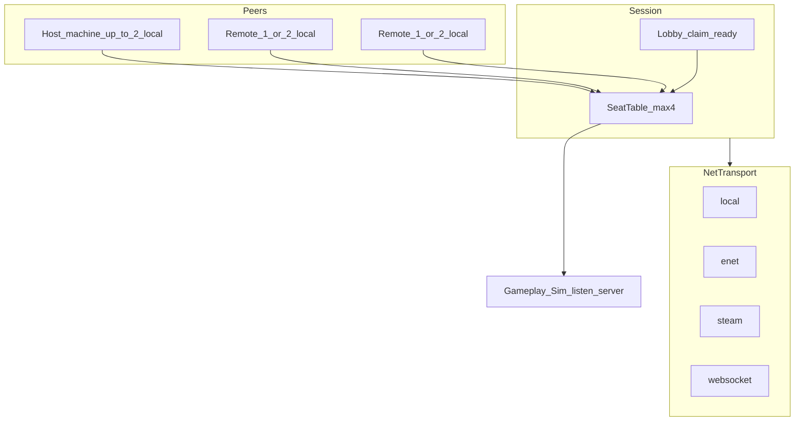

# 多人連線設計報告（本機二＋線上補滿至四人）

- **狀態：** 設計草案（尚未實作；非現行玩法規格）
- **範圍：** 本機合作、線上合作、以及兩者混合的同一 Session 模型；技術分層與平台差異
- **產品錨點：** 活線 `godot/game`（Godot 4.7）；版控見 `docs/versioning.md`
- **對照：** `docs/alpha/tech-review-v0.1.md`、`docs/systemdesign/ecosystem.md`、`docs/systemdesign/playerexport.md`、`docs/systemdesign/control.md`、`docs/systemdesign/savesystem.md`、`godot/game/scripts/platform_services.gd`
- **產出：** 2026-11-05

---

## 1. 摘要

| 項目 | 建議決議 |
| --- | --- |
| 主目標 | **同一對局：** 本機最多二人，並可再加入線上玩家，**全房操作座位最多四人** |
| 房間硬上限 | `room_max_seats = 4` |
| 每機本機上限 | `per_peer_max_local_seats = 2`（v1 不做一機 3～4 人） |
| 權威 | Listen-server（房主跑完整模擬）；client 只送**輸入意圖** |
| 核心模型 | **Seat ≠ Peer**：一個連線可佔 1～2 個 seat；協定以 `seat_id` 為準 |
| 引擎方案 | Godot High-level Multiplayer（`@rpc` + 可替換 `MultiplayerPeer`） |
| 後端 | 四人小房；**不必** MMO／專用叢集。Steam 用平台網路；Web 用自架房間／中繼 |
| 跨平台互通 | v1 **不**承諾 Steam↔Web↔主機互通 |
| 最大風險 | 同店即時需重構模擬權威與多 seat 輸入；不是選哪家雲 |

一句話：**純本機雙人、純線上四人、本機二再線上補位，共用同一套 SeatTable；傳輸可換，玩法不綁死 peer 實作。**

---

## 2. 現況與落差

### 2.1 已有（對多人有利）

- 單一活線工程；平台差異走匯出預設 + `PlatformServices` + feature flag（見 `docs/versioning.md`）
- `PlatformServices`：存檔／掛起／UI profile（`touch`｜`gamepad`｜`tv`）
- InputMap + Autoload `Controls`；手把不寫死 device 0（見 `control.md`）
- 暫停／掛起 checkpoint（見 `pausemenu.md`）
- 匯出：Web → Pages；Win／Linux Steam 候選（尚未接 Steamworks）

### 2.2 缺口

- 無 `MultiplayerPeer`／`@rpc`／大廳程式碼
- 模擬與輸入高度耦合於大型腳本（經營主控、`player.gd` 等）
- `ecosystem.md` 假設「每個商店只有一位玩家角色」
- 角色導出為本機 JSON、不做連線（`playerexport.md`；Alpha plan 亦列「連線對戰或即時同步導出」不做）
- Web 無法使用裸 ENet UDP
- 主機線上涉及 SDK／認證／商務，遠晚於 Steam／Web
- tech-review 原評估「單機較易過認證」— 上線上會擴大 Switch／Xbox 範圍

### 2.3 本報告不涵蓋

- 換引擎
- 40+ 人對戰／競技 rollback netcode
- v1 承諾跨發行平台全互通
- 本機三～四人或四分割螢幕作為上架賣點

---

## 3. 人數與混合座位模型

### 3.1 硬約束（建議拍板）

| 常數 | 值 | 說明 |
| --- | --- | --- |
| `room_max_seats` | 4 | 全房操作座位上限 |
| `per_peer_max_local_seats` | 2 | 任一客戶端機器最多本機座位 |
| `claim_seats` | 1 或 2 | 加入／開房時宣告；`current + claim ≤ 4` 否則拒絕 |

- 一機兩座位＝兩套 device 綁定（手把／鍵鼠），**不是**分屏四人。
- 大廳階段可開放線上補位；開日後是否允許中途加入 → 見 §10（預設：**不允許**中途加入）。

### 3.2 允許的房間組成

| 組成示例 | Seat 分配 | 說明 |
| --- | --- | --- |
| 本機 2 | 同機 seat×2 | 線上 peer＝0；仍走 Session，`transport` 可為 `local` |
| 本機 2 + 線上 2 | Host 佔 2；兩名 remote 各佔 1 | **主打混合目標** |
| 本機 2 + 線上 1（對方本機 2） | 兩機各 2 | 總座位 4；雙方都是雙人沙發 |
| 線上 4×1 | 四機各 1 | 經典連線合作 |
| 本機 1 + 線上 1～3 | Host 1 + remotes | 單人開房等人 |

### 3.3 Seat ≠ Peer

```text
Peer (一條連線 / 一台邏輯客戶端)
  └─ 擁有 1～2 個 Seat
        └─ 各對應一個可控角色（或觀戰權限）
```

- RPC／輸入意圖一律帶 **`seat_id`**，禁止假設「一人一 peer」。
- Host 本機座位可短路進模擬（不必出網）；遠端座位由擁有該 seat 的 peer 上送意圖。

### 3.4 SeatTable 欄位最小集

| 欄位 | 說明 |
| --- | --- |
| `seat_id` | 0～3 |
| `owner_peer_id` | 擁有此座位的 peer |
| `local_index` | 該機第幾手（0 或 1） |
| `ready` | 大廳就緒 |
| `role_flags` | 完整操作／觀戰等（備案用） |

---

## 4. 產品模式

多人不是單一功能。建議同一 Session 掛不同對局模式；**混合座位涵蓋純本機與純線上**。

| ID | 模式 | 體驗 | 同步難度 | 與主目標關係 |
| --- | --- | --- | --- | --- |
| **A** | 同店即時合作 | 最多 4 seat 同一店鋪經營 | 極高 | **主路徑**；混合座位服務此模式 |
| **B** | 本機分控 | 同機 1～2 seat，`transport=local` | 中 | A 的零延遲切片；可再掛線上補位 |
| **C** | 異店並行／競賽 | 最多 4 人各開一店比分數 | 低～中 | 附加；可較早驗證 Session |
| **D** | 非即時幫手 | 導出角色當店員（線上化傳輸） | 低 | 附加；滿足不了「開一局四人」 |
| **E** | 觀戰／受限座位 | 部分 seat 僅觀戰或職能受限 | 中 | A 過肥時的備案；改 `role_flags`，不另開協定 |

### 4.1 建議採納路徑

1. Seat 協定與混合模型定稿（本文件）
2. 本機 2 seat + SeatTable（`transport=local`）可開一局
3. **同一協定**下 LAN／ENet 加入第 3、第 4 seat（驗收「本機二＋線上補位」）
4. Steam lobby／peer 換上同一 Session
5. Web backend（見 §7；本機二在觸控端另議）
6. 主機：單機或同平台後期；不阻塞上列

並行可選：C 或 D（不阻塞 2～3）。

### 4.2 備案房型

完整同店 4 操作座位為主。若後期過肥：部分 seat 降為觀戰／異店——**仍用同一 SeatTable**，只改 `role_flags`。

---

## 5. 同店規則（混合特有）

### 5.1 鏡頭與 UI

- **不做**四分割。
- 有本機二的機器：單鏡頭（中點或焦點切換）+ 雙 HUD／標記。
- 遠端玩家：世界標記／簡易指示；不要求本機螢幕為每人獨立鏡頭。

### 5.2 互動衝突（須先定規則再實作）

同貨架、同收銀台、同小偷、掉落歸屬、COMBO 搶人 → 鎖定／排隊／友善碰撞。四人同店時為 P0 企劃項（見 §10）。

### 5.3 職能

建議預設：四人皆可完整操作（技能／奧義），以便驗證混合目標。若平衡崩潰，再改為店主 + 受限店員位（仍用 `role_flags`）。

### 5.4 進度、存檔、經驗

- 與 `ecosystem.md`「一店一玩家」衝突 → **待企劃確認**後再改長線檔。
- 工程預設建議（草案）：**一份店舖進度掛在 host／店主**；訪客 seat 不覆寫主存檔；營業額歸店；經驗公式見 §10。

### 5.5 暫停

- 僅 **host 機**可觸發全房暫停；本機二共享同一暫停決策。
- Client 見暫停遮罩；對齊現有掛起／`PlatformServices` checkpoint 語意（host 側寫檔策略見 §10）。

### 5.6 斷線與補位

- **預設（草案）：** peer 斷線 → 釋放其名下所有 seat，大廳可再被他人 `claim`；開日後斷線則該角色移除或凍結至日結（實作選一，見 §10）。
- Host 離開：v1 可解散整房；介面預留 host migration，不必首版實作。

### 5.7 大廳流程

1. Host 選本機玩家人數 **1｜2** → 開房  
2. UI 顯示剩餘名額（`4 - occupied`）  
3. Join 端選加入為 **1｜2** 人（受剩餘名額與 `per_peer_max_local_seats` 限制）  
4. 全員 `ready` → 開日  
5. 純本機雙人：同上但無遠端；之後「邀請線上」＝掛上真實 peer，**不重寫玩法**

---

## 6. 技術架構

### 6.1 分層（對齊既有 PlatformServices 原則）

```text
Gameplay / Sim（權威世界）
        ↑ 只認 seat 輸入與權威結算
Session / Lobby / SeatTable
        ↑ 開房、claim、ready、開始日、斷線釋放
NetTransport（MultiplayerPeer 實作）
        ↑ local / ENet / Steam / WebSocket / 後期主機
PlatformServices（已有，旁路）
        ↑ 存檔、成就、UI profile、掛起
```



**禁止**在 `player.gd`／經營主控裡直接 `ENetMultiplayerPeer.new()`。玩法只呼叫 Session／InputRouter。

### 6.2 Godot 元件

| 元件 | 用途 |
| --- | --- |
| `MultiplayerAPI` + `@rpc` | 遠端呼叫；玩法對這層寫 |
| `MultiplayerPeer` | 傳輸可替換介面 |
| `ENetMultiplayerPeer` | 桌面／LAN／自架 listen 的 UDP 預設 |
| `WebSocketMultiplayerPeer` | Web 匯出（瀏覽器無裸 UDP） |
| `WebRTCMultiplayerPeer` | 可選 P2P；需 signaling；桌面要 GDExtension |
| `MultiplayerSpawner`／`Synchronizer` | 適合角色表現；**禁止**盲目複製整店庫存／客人 AI |

### 6.3 Transport 對照

| Backend | Transport | Session／身份 |
| --- | --- | --- |
| `local` | 假 peer／不開網路 | 同進程 seat；可稍後掛真 peer |
| `lan_enet` | ENet | IP:port 或 LAN browse；驗證混合補位 |
| `steam` | SteamMultiplayerPeer（GodotSteam 等） | Steam Lobby + 邀請 |
| `web_ws` | WebSocketMultiplayerPeer | 自架房間服務 |
| `console_*` | 平台 peer（後期） | 平台 session |

### 6.4 InputRouter

- 每機讀取最多兩套 device → 映射 `local_index` → 打上 `seat_id`。
- Host 擁有的本機 seat：意圖直接進 Sim。
- 遠端 seat：可靠／不可靠通道上送（見 §8）。
- 擴充現有 InputMap／`Controls` 時保留「不寫死 device 0」原則（見 `control.md`）。

### 6.5 概念 API（穩定抽象）

```text
INetTransport
  create_host(config) / join(address_or_ticket)
  get_peer() -> MultiplayerPeer
  poll() / close()

ISessionService
  create_room(local_seat_count) / join_room(claim_seats)
  seat_table / set_ready / start_run
  signals: peer_joined, peer_left, seats_changed, start_day, disconnect

InputRouter
  poll_local() -> Array[Intent]  # 每 Intent 含 seat_id
```

可選後期：`IIdentity`（顯示名／平台帳號）。

### 6.6 環境與運維（線上最小）

- 開發：本機雙視窗、LAN 兩～三機（一機開本機二）
- Staging：小 VPS（房間服務；Web 可選 relay／TURN）
- 正式：Steam 路徑可大幅減自建；Web 維持房間服務
- 監控：斷線率、RTT、`claim` 拒絕原因
- 主機：另案；不阻塞 Steam／Web

---

## 7. 跨平台一案

### 7.1 Feature flag（建議）

- `multiplayer_session`（Seat／Session 總開關）
- `net_local` / `net_enet` / `net_steam` / `net_websocket`
- Web 包：預設 `net_websocket`；本機二是否啟用見 §10
- Steam 包：`net_steam`（可另留 `net_enet` 供 LAN 除錯）
- 主機：另 flag；預設可關線上

### 7.2 互通矩陣（產品真相）

| 組合 | v1 |
| --- | --- |
| 同機本機二 | 要（全平台可做輸入；主機 UI 另驗） |
| LAN 混合補位 | 要（桌面優先） |
| Steam↔Steam | 要（上架線上主路徑） |
| Web↔Web | 要（試玩／房間碼） |
| Steam↔Web | 不要（除非自有中繼專案） |
| 主機↔其他 | 不要（同平台後期另案） |

「一個方案」＝**同一 Session／Seat／權威模擬**；不是一個 UDP 連全世界。

### 7.3 與 PlatformServices 的邊界

- 存檔／掛起／成就／UI profile → 繼續只走 `PlatformServices`
- 開房／座位／傳輸 → **新建 Session 層**，不要塞進 `platform_services.gd`
- 與 tech-review「玩法只呼叫介面、後端可換」同一原則

---

## 8. 同店同步契約

### 8.1 Host 擁有

世界時鐘、客人／小偷／店員 AI、庫存與掉落、收銀結果、技能結算、營業額／經驗結算、Seat 角色權威狀態。

### 8.2 各 seat 擁有 peer 只送

輸入意圖：移動向量、action 按下／放開、技能選項、瞄準點等。  
**禁止** client 宣告「我撿了 N 件某某」。

### 8.3 分頻

| 通道 | 內容 |
| --- | --- |
| 不可靠／高頻 | 角色位置、面向 |
| 可靠／事件 | 互動、技能、結算、關店、Seat 表變更 |
| 不同步 | 客人 AI 內部狀態（host 跑；client 播表現） |

不要對整店實體上滿 `MultiplayerSynchronizer`。四人＝最多 4 路意圖 + 表現快照，模擬負載仍以店內代理為主。

### 8.4 安全

當輸入為不可信；校驗 seat 是否屬於該 peer、頻率限制、拒絕越權 `seat_id`。

---

## 9. 里程碑與驗收

| 里程碑 | 內容 | 驗收 |
| --- | --- | --- |
| **M0** | 本文件與 Seat 協定對齊 | 企劃／工程讀過；§10 未决項有負責人 |
| **M1** | 本機 2 seat + SeatTable（`transport=local`） | 同機兩 device 開完一日；暫停／存檔行為符合草案 |
| **M2** | LAN／ENet 第 3、第 4 seat | **本機二的 host 接受線上補位至 4**；斷線釋放 seat |
| **M3** | Steam lobby／peer | 同一 Session；好友邀請進混合房 |
| **M4** | Web `web_ws` | Web↔Web 房間；本機二策略依 §10 |
| 並行可選 | 異店競賽或導出雲端 | 不阻塞 M1–M2 |

主機線上不列入上表臨界路徑。

---

## 10. 待企劃確認

下列不阻塞本報告作為工程基線，但**改長線規則檔前必須拍板**：

1. **存檔歸屬：** 僅 host／店主寫入？訪客進度如何保留？  
2. **經驗公式：** 全進店主／按貢獻分配／每 seat 各算一份？  
3. **職能限制：** 四人全技能 vs 受限店員位  
4. **互動衝突表：** 貨架／收銀／小偷／COMBO 鎖定規則  
5. **開日後斷線：** 角色移除 vs 凍結至日結；座位是否可被中途佔用  
6. **中途加入：** 預設不允許；若允許需定義生成點與進度  
7. **Web 本機二：** 觸控＋雙人是否支援，或 Web 限每機 1 seat  
8. **是否啟用備案：** 部分 seat 觀戰的觸發條件  

拍板後再改 `ecosystem.md`／`playerexport.md`／相關操作文件；本草案不自行覆寫那些規則正文。

---

## 11. 參考連結

- `docs/alpha/tech-review-v0.1.md` — 平台與 `PlatformServices` 方針  
- `docs/versioning.md` — 單一活線、禁止平台專案複本  
- `docs/alpha/export-presets.md` — Web／Steam 候選匯出  
- `docs/alpha/console-business.md`、`docs/alpha/godot-middleware-pin.md` — 主機商務與釘版  
- `docs/systemdesign/ecosystem.md` — 現行一店一玩家進度  
- `docs/systemdesign/playerexport.md` — 導出店員（連線仍缺）  
- `docs/systemdesign/control.md`、`docs/systemdesign/inputmodes-vj.md` — 輸入  
- `docs/systemdesign/savesystem.md`、`docs/systemdesign/pausemenu.md` — 存檔與暫停  
- `godot/game/scripts/platform_services.gd` — 平台 facade  
- Godot 文件：High-level multiplayer、`MultiplayerPeer`、WebRTC 說明  

---

## 12. 結論

- **產品：** 本機最多二人，可線上補位至同房四人；純本機／純線上是同一模型的特例。  
- **工程：** SeatTable + listen-server + 可換 Transport；Intent 帶 `seat_id`。  
- **平台：** Steam／Web／LAN 各換 backend；v1 不承諾跨商店互通。  
- **下一步：** 對齊 §10 → 執行 M1（本機二）→ M2（混合補位）為硬驗收。
