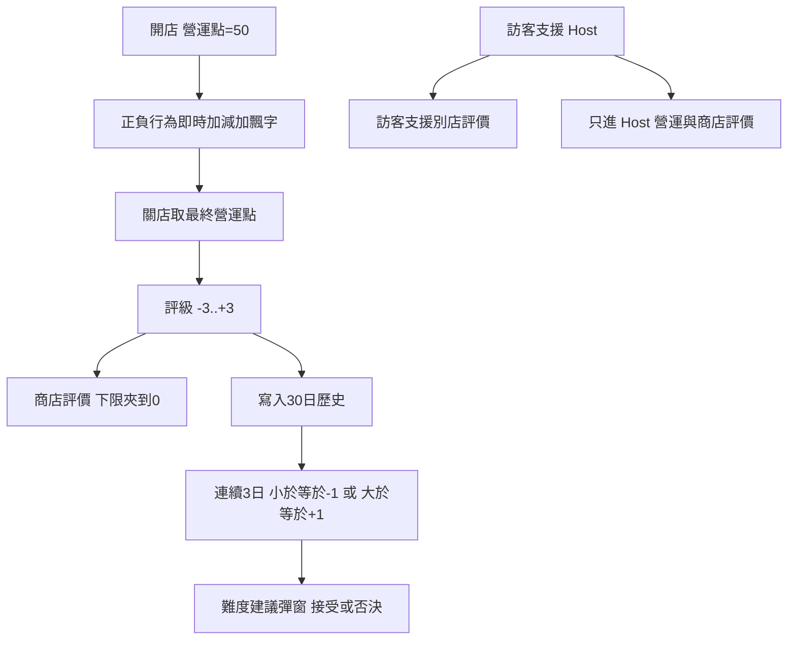

# 評價系統

- 此檔是長線評價規則（營運回合評價＋商店評價）
- 拍板：2026-11-08
- 工程活線：尚未實作（設計先於 code）
- 交叉：`ecosystem.md`、`storeoperationphase.md`、`savesystem.md`、`multiplayer.md`、`difficulty.md`、`cashiersystem.md`、`float_text`（營運飄字）

# 總覽

評價分兩層，**都不是可花貨幣**（不付開發費、不付擴張；廢除 Alpha 舊稿「經營值」花費義）。

| 層 | 用途 | 壽命 |
| --- | --- | --- |
| **營運回合評價（營運點）** | 當日表現；日結評級；事件／劇情／成就條件 | 每次開店重設為 **50** |
| **商店評價** | 長期表現；事件／劇情／成就條件；難度建議輸入 | 持久於店檔；起始 **0** |

店舖功能解鎖（貨架／開發／擴張）仍只看**角色等級**（`shopprogress.md`），不看評價。

# 營運回合評價

## 基本

- 每次進入營運（開店）時重設：**營運點 = 50**
- **無上限、無下限**（可負、可超過 100）
- 營運中每發生一筆已定行為，立刻加減營運點，並：
  - **HUD** 顯示當前營運點（營運時段）
  - **飄字** 顯示本次 Δ（正綠／負紅；可與 `$`／XP／不滿飄字並存，堆疊見 `scripts/ui/float_text.gd`）
- 日結評級**只看最終營運點**，不混營業額、虧損、提早關店等其他軸
- 店員／Dark Side 臨時工／多重影分身完成的收銀、清潔等，一樣計入 **Host 店**營運點

## 評級帶（日結）

| 最終營運點 | 文案 | 評級 |
| --- | --- | --- |
| &lt; 0 | 你還在嗎？ | −3 |
| 0–20 | 超負評 | −2 |
| 21–40 | 負評 | −1 |
| 41–60 | 普通 | 0 |
| 61–80 | 好評 | +1 |
| 81–100 | 大獲好評 | +2 |
| &gt; 100 | 超好評 | +3 |

（**100 算大獲好評**；超過 100 才超好評。）

## 行為加減（已拍板）

原則：只計**離散結果事件**。找不到貨、排隊、踩污物、麻煩光環等不滿 tick **不直接**改營運點（匯流到「生氣離開」才罰）。安撫／技能減不滿、奧義趕客等不另加減。資金、XP、採購、開發、擴張不計。

### 正面

| ID | 行為 | 觸發 | Δ |
| --- | --- | --- | --- |
| P1a | 完美收銀 | 付完一筆，且該次指令過程**從未**輸入錯誤（無重置／無 X）。資深收銀員縮短串、LV3 免方向直接 Circle → 視為完美 | **+3** |
| P1b | 普通收銀 | 付完一筆，但過程曾錯過至少一次指令後重來；或**全體集資／割韭菜**等略過指令的入帳 | **+1** |
| P2 | 收完麻煩客人 | 該筆 elite 收銀成功 | **+10**（含該筆，**不再另加 P1**；完美／曾錯過皆 +10） |
| P3 | 抓住小偷 | 近身 KO／貨箱砸中／衝刺撞飛（落閘放狗打斷不計逃走／被偷，之後抓住仍可 P3） | **+5** |
| P4 | 成功清潔 | 清完一團污物 | **+1** |
| P5 | COMBO 達成 | 交付達標使個人／全隊 COMBO +1 的那一次 | **+1** |

正確交付本身不另計（避免與 P5／之後收銀雙重）。

### 負面

| ID | 行為 | 觸發 | Δ |
| --- | --- | --- | --- |
| N1 | 客人生氣離開 | 不滿滿 100 離店 | **−5** |
| N2 | 被偷一件 | 小偷帶贓物走出大門（每件） | **−2** |
| N3 | 小偷逃走 | 該名小偷成功離店且計逃走 | **−3**（可與當次 N2 疊加） |
| N4 | 交錯／丟錯貨 | 親手或丟掉對客人交錯 SKU | **−1** |
| N5 | 衝刺撞倒一般客人 | 無禮衝撞（禮貌衝撞除外） | **−1** |
| N6 | 打擊失敗被小偷撞倒 | 玩家倒地那次 | **−2** |

**不計：** 當日虧損標籤、提早關店／跳過營運的額外罰（點數停在關店當下）。

# 商店評價

- 記錄玩家（**Host 店**）長期總評級點數
- **起始 0**；**下限 0**；**無上限**；**不衰減**
- 日結：`shop_rating = max(0, shop_rating + 評級)`  
  （評級 −3…+3 各對商店評價 −3…+3；評級 0 → 0）
- 主要作達成條件：事件、劇情、成就、其他（日後再定）
- **不可**花在開發／擴張

## 歷史

- 保留最近 **30 日**日結評級（可查看、作表現分析）
- 寫入時機：每次關店結算（含提早關店／跳過營運）
- 超過 30 筆丟最舊

## 難度建議（介面見 `difficulty.md`）

- 最近連續 **3 日**評級皆 **≤ −1** → 建議調低難度  
- 最近連續 **3 日**評級皆 **≥ +1** → 建議調高難度  
- 彈出提問窗：可**即時改難度**或**否決**（否決不改難度；是否冷卻再提示由難度檔定）

# 多人／線上

- **營運點與商店評價只算 Host 店**（本機 M1 與線上開房皆然）
- 線上訪客在 Host 店協助：**不**改訪客自己店的商店評價
- 訪客另開 **「支援別店評價」**（角色／訪客槽欄位）：日結  
  `support_rating += 該局 Host 評級`（可為負，以反映幫倒忙；**支援點本身不設下限**，與商店評價下限 0 不同）
- 本機 M1 訪客槽同樣記入支援別店評價（無自己店）

# 達成條件（語意）

事件／劇情／成就可引用（表內容 Beta 後補）：

- 單日最終營運點／評級  
- 商店評價達標  
- 歷史窗口內評級統計（例如最近 30 日平均、連續好評日數）  
- 支援別店評價達標（訪客向）

# 存檔欄位（設計）

店主檔（見 `savesystem.md`）：至少 `shop_rating`、`rating_history`（最多 30 筆評級）、`difficulty`（見難度檔）。  
營運點為局內狀態，關店寫入歷史後不需長期保留當日中途值（可選存 `last_ops_rating`／`last_grade` 供 UI）。  
訪客槽／線上角色：`support_rating`。

# 與舊稿

- `gameconcept.md`「經營值」改讀本檔評價；**不是**可花貨幣  
- `docs/alpha/plan.md` 經營值解鎖／花費段落為**歷史**，以本檔＋`shopprogress`＋資金為準
